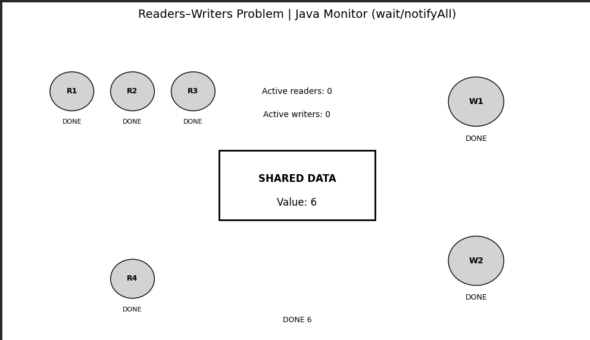
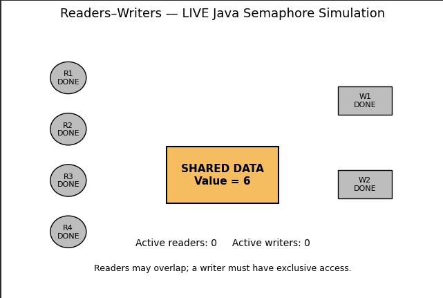
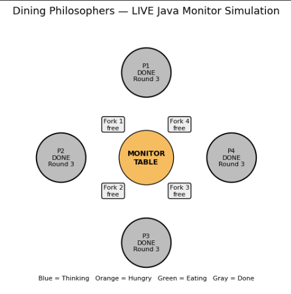
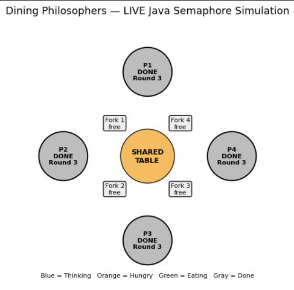

# Operating Systems Synchronization Simulations

This repository contains four synchronization simulations implemented using Java concurrency mechanisms, with Python-based visualizations.

## Simulations

1. **Readers–Writers using Monitor** — demonstrates coordination between readers and writers using monitor-style synchronization.
2. **Readers–Writers using Semaphore** — demonstrates concurrent readers and exclusive writers using semaphores.
3. **Dining Philosophers using Monitor** — demonstrates monitor-style synchronization with Java's `synchronized`, `wait()`, and `notifyAll()`.
4. **Dining Philosophers using Semaphore** — demonstrates fork sharing and synchronization using semaphores.

## Repository Structure

```text
os-task-2/
├── simulations/
│   ├── readers_writers_monitor.py
│   ├── readers_writers_semaphore.py
│   ├── dining_philosophers_monitor.py
│   └── dining_philosophers_semaphore.py
├── docs/
├── screenshots/
│   ├── readers-writers-monitor.png
│   ├── readers-writers-semaphore.png
│   ├── dining-philosophers-monitor.png
│   └── dining-philosophers-semaphore.png
└── README.md
```

## Requirements

- Python 3
- Java JDK (includes `java` and `javac`)
- Python packages: `matplotlib` and `ipython`
- Jupyter Notebook or Google Colab is recommended because the scripts use live display updates.

## Setup

Install the Python packages:

```bash
pip install matplotlib ipython
```

Install a Java JDK if it is not already installed. Confirm both Java commands are available:

```bash
java -version
javac -version
```

In Google Colab, if Java is missing, run:

```python
!apt-get update -qq && !apt-get install -y openjdk-21-jdk-headless
```

## Running the Simulations

Run a script from a Python notebook or a compatible Python environment. For example:

```python
%run simulations/readers_writers_monitor.py
```

Replace the filename with any of the other three scripts to run a different simulation.

The scripts compile their embedded Java source code and then run the Java simulation while Python displays the changing process states.

> **Note:** These scripts were written for notebook-style live visualization. They use paths under `/content/`, so a local environment may require adapting those paths.

## Screenshots

### Readers–Writers using Monitor



### Readers–Writers using Semaphore



### Dining Philosophers using Monitor



### Dining Philosophers using Semaphore



> Upload the four images to the `screenshots/` folder using the exact filenames shown above for the images to render here.

## Concepts Demonstrated

- Mutual exclusion
- Thread synchronization
- Concurrent readers and exclusive writers
- Semaphore-based coordination
- Monitor-style synchronization
- Shared resources and race-condition prevention

## Author

**Chirag Sharma**
